# 📘 Manual de Usuario — Luminance Estética

Guía de uso del sistema de turnos y pagos online de **Luminance Studio by Cande**.

- **Parte 1 — Guía para clientas:** cómo conocer los servicios, reservar, pagar y gestionar tus turnos.
- **Parte 2 — Guía de administración:** cómo la dueña del estudio gestiona la agenda, los cobros, el catálogo, las clientas y los reportes.

> [!NOTE]
> *Luminance Studio by Cande* es un estudio ficticio creado para un proyecto de portfolio. Los
> nombres, servicios, precios y datos que se ven en las capturas son de demostración.

## Índice

**Parte 1 — Guía de uso para clientas**

1. [Primer ingreso: cuenta e inicio de sesión](#1-primer-ingreso-cuenta-e-inicio-de-sesión)
2. [Navegación del catálogo y consulta de servicios](#2-navegación-del-catálogo-y-consulta-de-servicios)
3. [Reserva de turnos online, paso a paso](#3-reserva-de-turnos-online-paso-a-paso)
4. [Métodos de pago y confirmación](#4-métodos-de-pago-y-confirmación)
5. [Panel «Mis Turnos»: seguimiento y cancelaciones](#5-panel-mis-turnos-seguimiento-y-cancelaciones)
6. [Emails automáticos](#6-emails-automáticos)

**Parte 2 — Guía de administración**

7. [Ingreso al sistema y seguridad](#7-ingreso-al-sistema-y-seguridad)
8. [Agenda diaria y semanal](#8-agenda-diaria-y-semanal)
9. [Catálogo de servicios](#9-catálogo-de-servicios)
10. [Auditoría y aprobación de pagos](#10-auditoría-y-aprobación-de-pagos)
11. [Clientes e historial](#11-clientes-e-historial)
12. [Horarios de atención y fechas especiales](#12-horarios-de-atención-y-fechas-especiales)
13. [Reportes y métricas](#13-reportes-y-métricas)

[Preguntas frecuentes](#preguntas-frecuentes)

---

# Parte 1 — Guía de uso para clientas

## 1. Primer ingreso: cuenta e inicio de sesión

Al entrar al sitio se muestra la página de presentación, con dos caminos:

- **Ingresar al Sitio Principal:** muestra el estudio, los servicios, los cursos y los testimonios.
- **Reservar Turno Online:** lleva a la turnera. Para reservar es necesario tener una cuenta.

El botón flotante de WhatsApp, abajo a la derecha, abre un chat directo con el estudio para cualquier consulta.

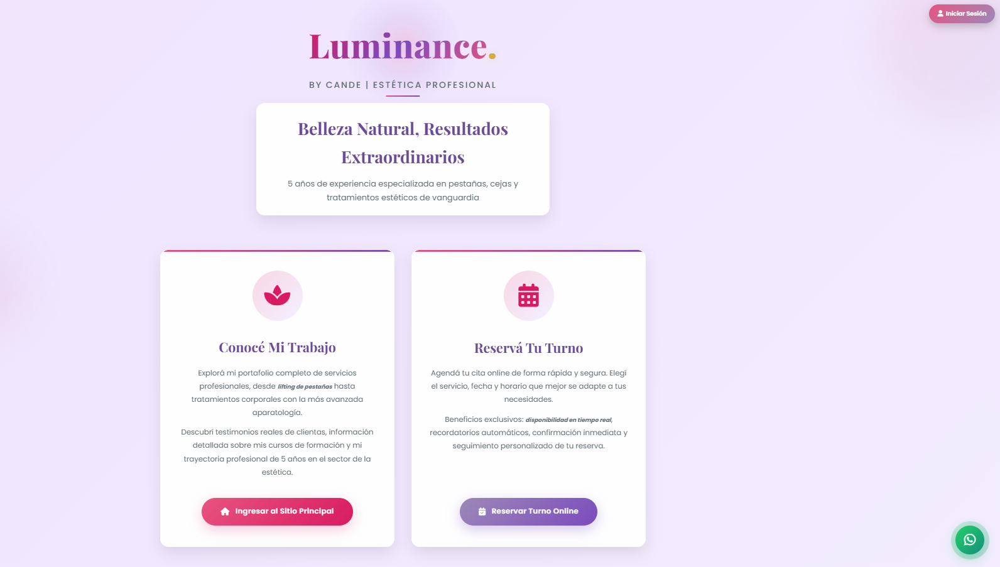

### Crear una cuenta

En **Iniciar Sesión → «Registrate aquí»** completá tu nombre completo, email, teléfono (opcional) y una contraseña. Al registrarte recibís un email de bienvenida.

### Iniciar sesión

Hay dos formas de ingresar:

- **Con email y contraseña.**
- **Con Google («Continuar con Google»).** No necesitás crear una contraseña: la primera vez que entrás se crea tu cuenta automáticamente.

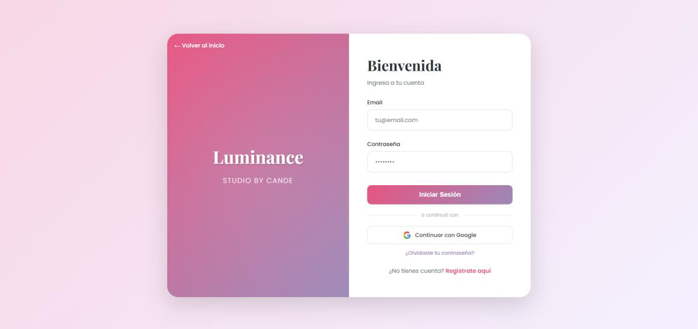

### Recuperar la contraseña

1. En la pantalla de inicio de sesión, tocá **«¿Olvidaste tu contraseña?»**.
2. Ingresá el email de tu cuenta y tocá **Enviar instrucciones**.
3. Vas a recibir un email con un **código de verificación**, válido por **1 hora**.
4. Ingresá el código y tu nueva contraseña dos veces. Cuando se guarda, te llega un email avisando que tu contraseña fue actualizada.

## 2. Navegación del catálogo y consulta de servicios

Con la sesión iniciada, el sitio principal (**Studio**) muestra el catálogo completo. La barra superior es igual en todas las páginas:

| Elemento | Para qué sirve |
|---|---|
| **Studio** | Volver al sitio principal del estudio. |
| **Reservar Turno** | Abrir la turnera online. |
| **Mis Turnos** | Ver y gestionar tus reservas. |
| **Hola, *tu nombre*** | Indica con qué cuenta ingresaste. |
| **Salir** | Cerrar la sesión. |

Debajo hay un menú con las secciones de la página: **Inicio**, **Servicios** (con un desplegable por categoría: pestañas, cejas, láser, faciales, corporales y pies), **Cursos**, **Sobre Mí**, **Formación**, **Testimonios** y **Contacto**. Cada servicio muestra su descripción, duración y precio. Los botones de WhatsApp abren un mensaje ya escrito para consultar por ese servicio o curso.

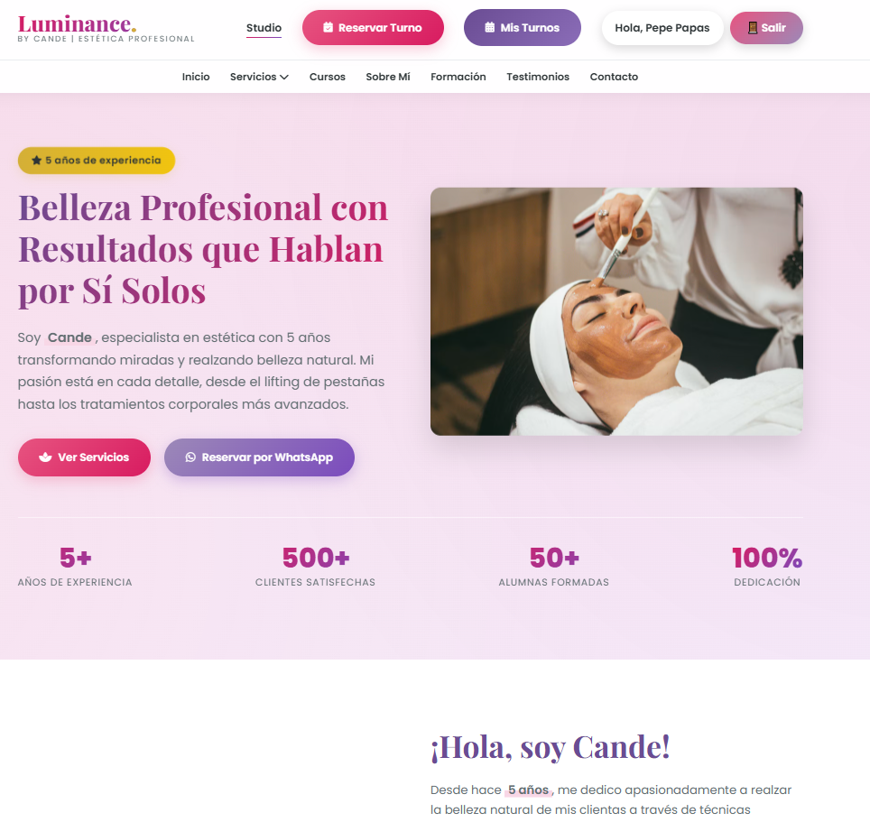

> [!TIP]
> El catálogo de la turnera siempre muestra los **precios vigentes**: si el estudio actualiza un precio,
> el cambio se ve en el momento.

## 3. Reserva de turnos online, paso a paso

Tocá **Reservar Turno**. La turnera tiene cuatro pasos, y el indicador superior (*Fecha → Servicio → Horario → Confirmar*) muestra en cuál estás.

### Paso 1: elegí la fecha

El calendario muestra los días en los que se puede reservar, **hasta 30 días hacia adelante**. Usá las flechas para cambiar de mes.

- Los días en gris no están disponibles: ya pasaron, superan los 30 días o el estudio no atiende (por ejemplo, los domingos o un feriado).
- Los días con borde rojo y un número ya tienen turnos confirmados. El número indica cuántos. El día puede tener horarios libres igual.

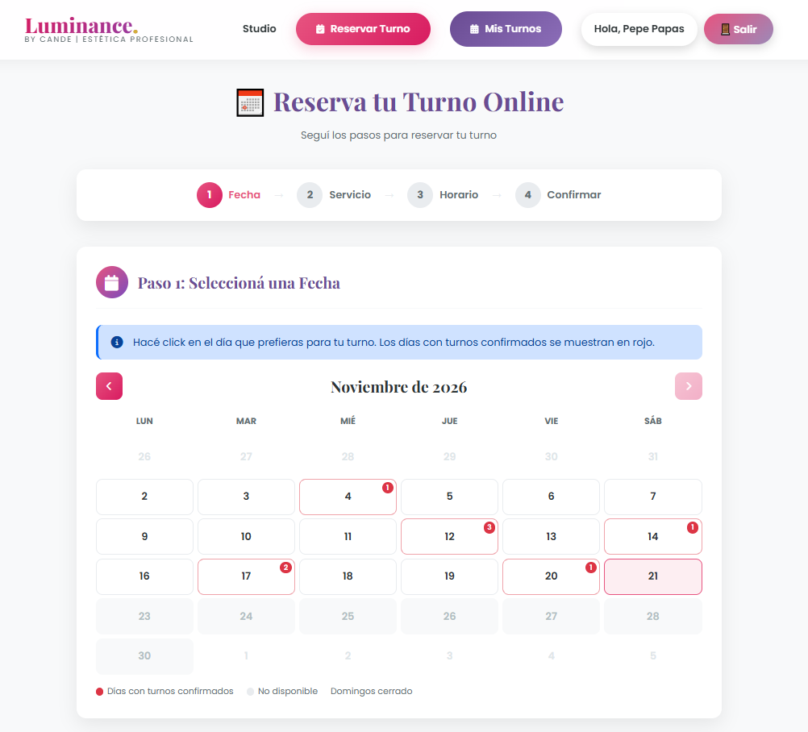

### Paso 2: elegí el servicio

Se listan los servicios activos con su **duración** y **precio**. Tocá el que quieras reservar.

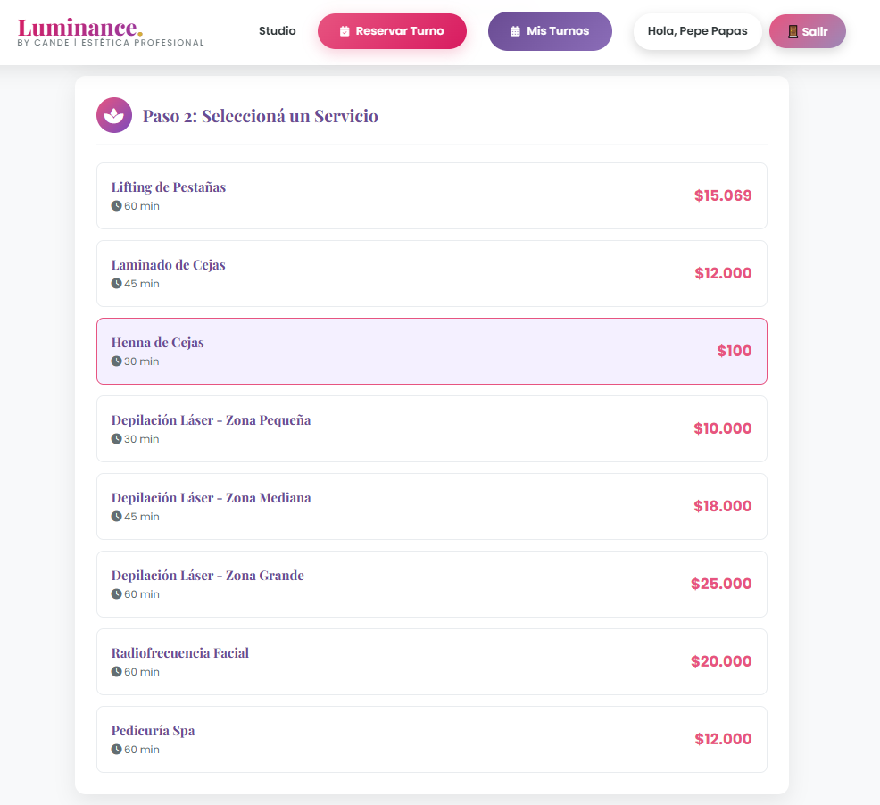

### Paso 3: elegí el horario

Los horarios se ofrecen **cada 30 minutos**, dentro del horario de atención de ese día, y solo los que permiten terminar el servicio antes del cierre.

Un horario **no** se puede elegir si:

- se superpone con otro turno ya confirmado, o
- empieza dentro de las próximas **2 horas** (anticipación mínima).

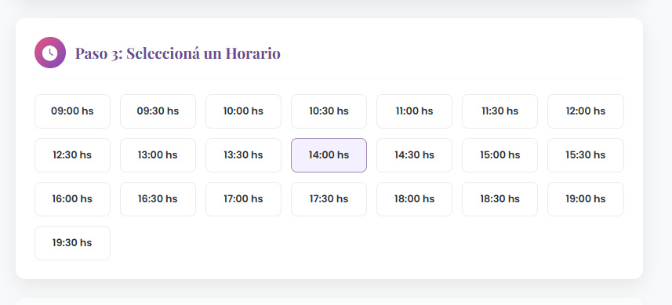

### Paso 4: revisá y confirmá

El resumen muestra la fecha, el horario, el servicio, la duración y el precio. Tocá **Confirmar Reserva**.

Tu turno se crea con estado **«Pendiente de pago»** y el sistema te lleva directamente a la página de pago.

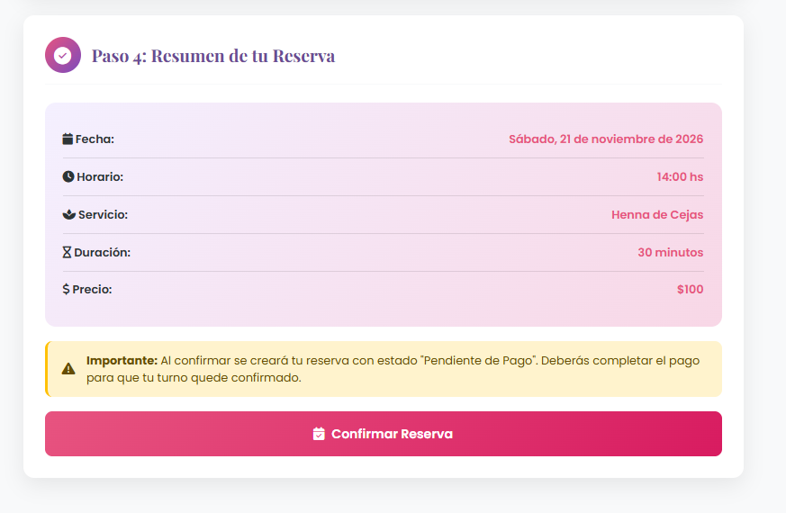

> [!IMPORTANT]
> Un turno pendiente **todavía no ocupa el horario**: el horario queda reservado para vos recién
> cuando el turno se confirma, es decir, cuando se aprueba el pago. Si otra persona paga ese mismo
> horario antes, vas a tener que elegir otro. Te recomendamos pagar en el momento.

## 4. Métodos de pago y confirmación

La página **Confirmar tu Turno** muestra el resumen del turno, el total a pagar y los métodos disponibles. Elegí uno y tocá **Confirmar Pago**. Si te arrepentiste, **Cancelar Reserva** cancela el turno pendiente.

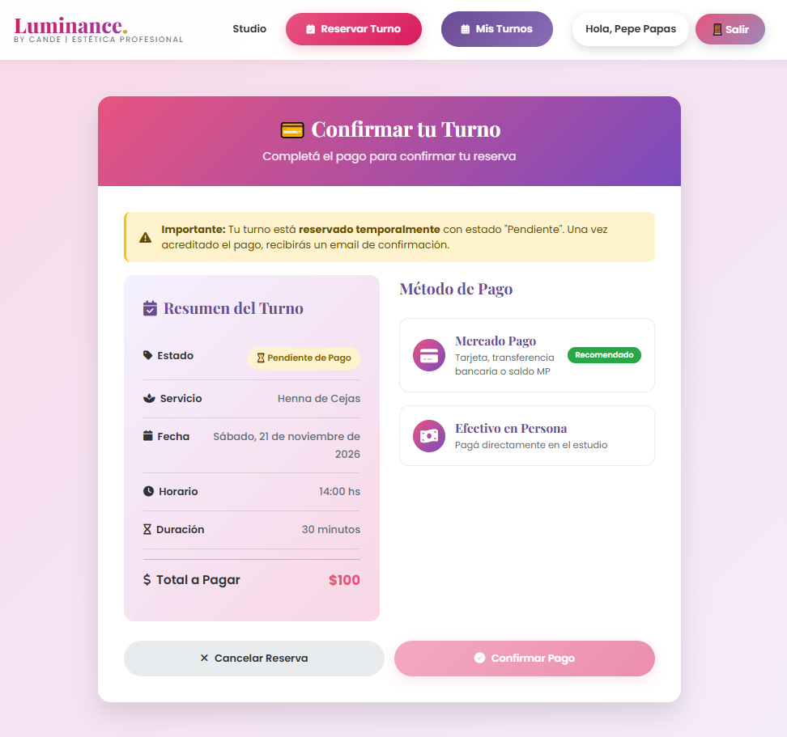

### Mercado Pago (recomendado)

Permite pagar con **tarjeta, transferencia bancaria o saldo de Mercado Pago**.

1. Al tocar **Confirmar Pago**, se te redirige al checkout seguro de Mercado Pago.
2. Completá el pago allí.
3. Mercado Pago te devuelve al sitio:
   - **«¡Pago Exitoso!»:** el pago se acreditó. En unos instantes el turno pasa a **Confirmado** y recibís el email **«Pago Confirmado»**.
   - **«Pago No Procesado»:** el pago fue rechazado o no se completó. El turno sigue pendiente y podés **reintentar el pago** desde la misma pantalla o desde **Mis Turnos**.

El monto que se cobra es siempre el precio del servicio registrado por el estudio.

### Efectivo en persona

1. Elegí **Efectivo en Persona** y tocá **Confirmar Pago**.
2. Se abre WhatsApp con un mensaje ya escrito con los datos de tu turno, para enviárselo a Cande.
3. El estudio te responde y **confirma tu reserva**. Pagás en efectivo cuando llegás al estudio.
4. Cuando el estudio registra la confirmación, el turno aparece como **Confirmado** en **Mis Turnos**.

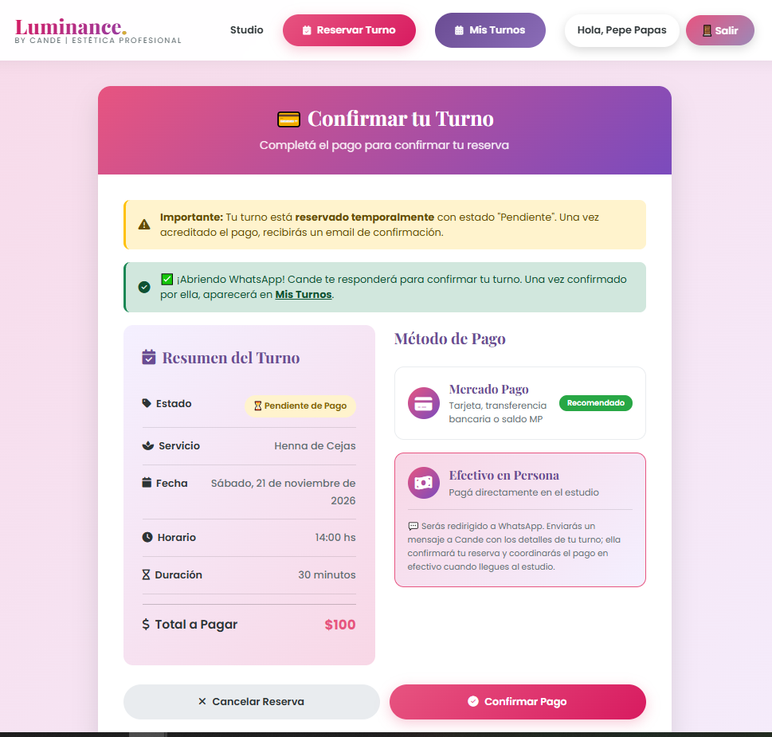

> [!NOTE]
> Si coordinaste con el estudio un pago por **transferencia** directa, el estudio lo registra
> manualmente al recibir el comprobante y tu turno queda confirmado. Ver
> [Auditoría y aprobación de pagos](#10-auditoría-y-aprobación-de-pagos).

## 5. Panel «Mis Turnos»: seguimiento y cancelaciones

En **Mis Turnos** están todas tus reservas, separadas en dos pestañas con su cantidad:

- **Próximos:** turnos pendientes o confirmados que todavía no ocurrieron.
- **Historial:** turnos pasados, completados o cancelados.

Cada tarjeta muestra el servicio, la fecha, la hora, la duración, el precio, el **estado del turno** y el **estado del pago**, incluido el medio de pago.

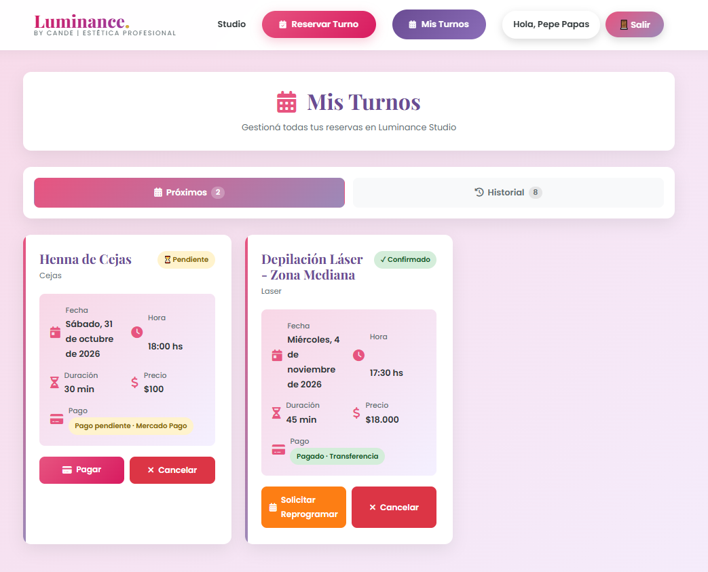

### Estados del turno

| Estado | Qué significa |
|---|---|
| ⏳ **Pendiente** | Reservado, falta el pago. El horario todavía no está asegurado. |
| ✓ **Confirmado** | Pago aprobado o confirmado por el estudio. El horario es tuyo. |
| ★ **Completado** | El turno ya se realizó. |
| ✕ **Cancelado** | El turno se canceló. En la tarjeta figura el motivo. |

### Acciones disponibles

| Botón | Cuándo aparece | Qué hace |
|---|---|---|
| **Pagar** | Turno pendiente | Vuelve a la página de pago para completar o reintentar el pago. |
| **Solicitar Reprogramar** | Turno confirmado | Abre WhatsApp con un mensaje con los datos del turno para pedir otra fecha u hora. Cuando el estudio cambia la fecha, recibís el email «Turno Reprogramado». |
| **Cancelar** | Turno pendiente o confirmado | Pide un **motivo** (entre 5 y 500 caracteres) y cancela el turno. Recibís un email de confirmación de la cancelación. |

> [!WARNING]
> La cancelación no se puede deshacer. Si cancelás un turno ya pagado, comunicate con el estudio por
> WhatsApp para coordinar la devolución o una nueva fecha.

## 6. Emails automáticos

El sistema te envía emails al correo de tu cuenta en estos casos:

| Email | Cuándo llega | Qué contiene |
|---|---|---|
| ✨ **¡Bienvenida a Luminance Studio!** | Al crear tu cuenta (también con Google, la primera vez). | Saludo de bienvenida y acceso al sitio. |
| 🔑 **Recuperar Contraseña** | Al pedir recuperar la contraseña. | El código de verificación, válido por 1 hora. |
| 🔒 **Tu contraseña fue actualizada** | Al cambiar la contraseña. | Aviso de seguridad. Si no fuiste vos, contactá al estudio. |
| ✅ **Pago Confirmado** | Cuando se aprueba el pago de tu turno (Mercado Pago, o registrado por el estudio). | Servicio, monto pagado, fecha y hora del turno. |
| 📅 **Turno Reprogramado** | Cuando el estudio cambia la fecha de tu turno. | Fecha anterior, nueva fecha y acceso a «Mis Turnos». |
| ❌ **Turno Cancelado** | Cuando se cancela un turno (por vos o por el estudio). | Servicio y fecha del turno cancelado. |

  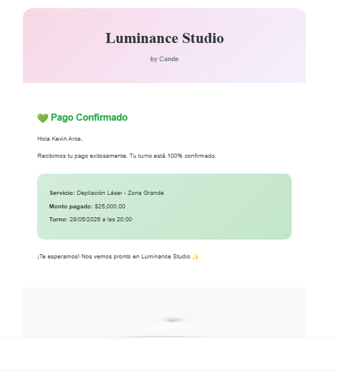
  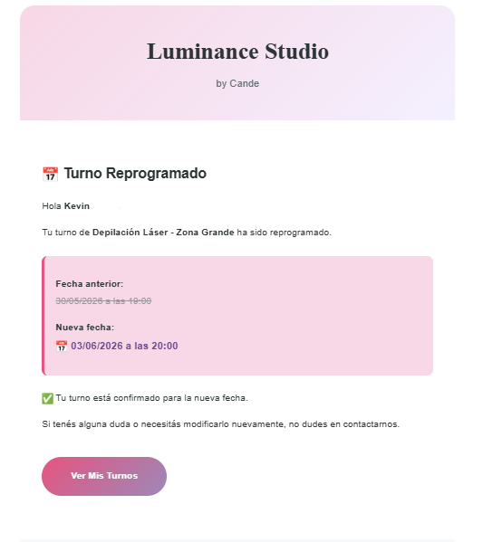

> [!TIP]
> Si no ves un email, revisá la carpeta de **spam** o **promociones**.

---

# Parte 2 — Guía de administración

## 7. Ingreso al sistema y seguridad

La administradora ingresa por la **misma pantalla de inicio de sesión** que las clientas, con email y contraseña o con Google. Si la cuenta tiene permisos de administración, la barra superior muestra el botón **Admin**, que abre el panel.

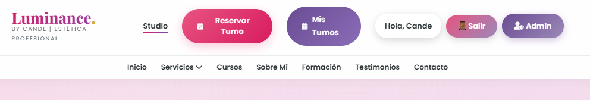

**Seguridad:**

- El panel y todas sus operaciones solo están disponibles para cuentas administradoras. Una clienta no puede verlo aunque conozca la dirección.
- La sesión se guarda en el navegador. En una computadora compartida, cerrala siempre con **Salir**.
- Para cambiar la contraseña se usa el mismo circuito de recuperación de las clientas: un código por email, válido por 1 hora.
- Las cuentas de clientas se pueden **desactivar** (ver [Clientes e historial](#11-clientes-e-historial)). Una cuenta desactivada no puede iniciar sesión.

El panel tiene un encabezado con el saludo, la fecha del día y el botón **Registrar turno presencial**, y seis pestañas: **Agenda**, **Servicios**, **Pagos**, **Clientes**, **Disponibilidad** y **Reportes**.

## 8. Agenda diaria y semanal

La pestaña **Agenda** es la pantalla de trabajo diaria.

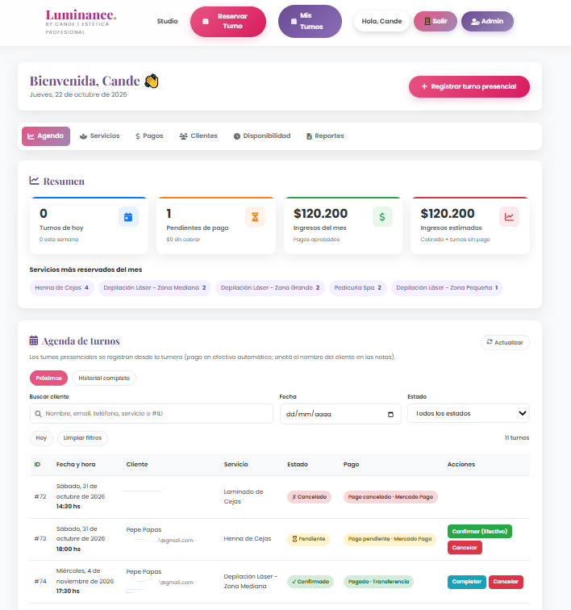

### Resumen

| Indicador | Qué muestra |
|---|---|
| **Turnos de hoy** | Turnos del día. Debajo, la cantidad de turnos **de esta semana**. |
| **Pendientes de pago** | Turnos reservados sin pago aprobado. Debajo, el monto **sin cobrar**. |
| **Ingresos del mes** | Suma de los pagos aprobados en el mes. |
| **Ingresos estimados** | Lo cobrado más lo que falta cobrar de los turnos pendientes. |

Debajo aparecen los **servicios más reservados del mes**, con su cantidad de turnos.

### Buscar y filtrar turnos

- **Próximos / Historial completo:** turnos que vienen, o todos, incluidos los pasados.
- **Buscar cliente:** por nombre, email, teléfono, servicio o número de turno (`#ID`).
- **Fecha:** un día puntual. El botón **Hoy** muestra la agenda del día.
- **Estado:** pendientes, confirmados, completados o cancelados.
- **Limpiar filtros** vuelve a la vista inicial, y **Actualizar** recarga los datos.

Cada fila muestra el número de turno, la fecha y hora, la clienta y su contacto, el servicio y sus notas, el estado del turno y el estado del pago.

### Cambiar el estado de un turno

| Acción | Disponible para | Resultado |
|---|---|---|
| **Confirmar (Efectivo)** | Turnos pendientes | Registra el pago en efectivo como aprobado y **confirma** el turno. |
| **Completar** | Turnos confirmados | Marca el turno como **Completado** una vez realizado. |
| **Cancelar** | Turnos pendientes o confirmados | Pide un **motivo** obligatorio y cancela el turno. La clienta ve el motivo en «Mis Turnos» y recibe un email. |

Cada acción pide confirmación antes de ejecutarse.

> [!IMPORTANT]
> El sistema **no permite confirmar dos turnos superpuestos**. Si el horario ya está ocupado por otro
> turno confirmado, la confirmación se rechaza con un aviso y no se registra ningún cobro: hay que
> coordinar otra fecha con la clienta.

### Registrar un turno presencial

Para clientas que reservan por teléfono o en el estudio:

1. Tocá **Registrar turno presencial**. Se abre la turnera.
2. Elegí fecha, servicio y horario, igual que una clienta.
3. En las **notas**, anotá el nombre de la clienta.
4. Al confirmar, el turno queda **confirmado con pago en efectivo aprobado** automáticamente.

## 9. Catálogo de servicios

La pestaña **Servicios** lista todos los servicios con su categoría, duración, precio y estado.

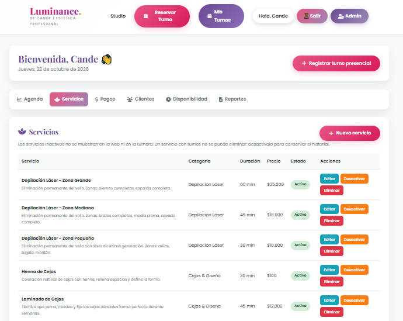

| Acción | Uso |
|---|---|
| **Nuevo servicio** | Alta de un servicio: nombre (único), categoría, duración en minutos, precio en pesos, descripción y una imagen opcional. |
| **Editar** | Modificar cualquiera de esos datos, por ejemplo para **actualizar el precio** o la **duración**. |
| **Desactivar / Activar** | Un servicio inactivo deja de mostrarse en el sitio y en la turnera, pero conserva su historial. |
| **Eliminar** | Solo se puede eliminar un servicio que **nunca tuvo turnos**. Si tiene turnos, hay que desactivarlo. |

Recomendaciones:

- **Cambios de precio:** el nuevo precio se aplica a los pagos que se inicien desde ese momento. Los pagos ya aprobados conservan el monto cobrado.
- **Cambios de duración:** afectan a los horarios que ofrece la turnera, porque cada turno ocupa la duración de su servicio.
- **Bajas temporales** (por ejemplo, un equipo en reparación): conviene **desactivar** y no eliminar.

## 10. Auditoría y aprobación de pagos

La pestaña **Pagos** concentra el control de los cobros.

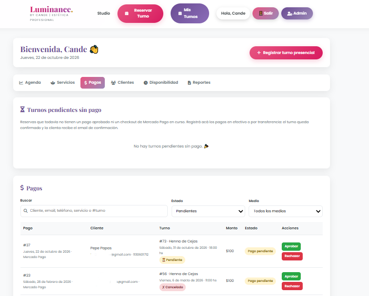

### Turnos pendientes sin pago

Son las reservas que todavía no tienen un pago aprobado ni un checkout de Mercado Pago en curso. Para registrar un cobro recibido fuera del sitio:

1. Tocá **Registrar pago** en el turno.
2. Elegí el medio: **Efectivo en el estudio** o **Transferencia bancaria**.
3. Para transferencias, ingresá el **número de operación o comprobante**. También podés agregar notas.
4. Tocá **Registrar y confirmar turno**: el pago queda aprobado, el turno se confirma y la clienta recibe el email «Pago Confirmado».

### Listado de pagos

Por defecto muestra los pagos **pendientes**. Se puede filtrar por **estado** y por **medio de pago**, y buscar por clienta, email, teléfono, servicio o número de turno. Cada pago muestra la clienta, el turno, el monto, el estado y, si corresponde, el comprobante o el motivo de rechazo.

| Acción | Resultado |
|---|---|
| **Aprobar** | Pide confirmación. El pago pasa a **Aprobado** y el turno a **Confirmado**. |
| **Rechazar** | Pide un **motivo**, por ejemplo «comprobante ilegible», que queda guardado en el pago. El turno **sigue pendiente**, así la clienta puede volver a pagar. |

**Cómo auditar:**

- Los pagos con **Mercado Pago** se confirman **solos**: Mercado Pago avisa al sistema cuando el pago se acredita. Aprobalos a mano solo después de verificar el cobro en tu cuenta de Mercado Pago.
- Las **transferencias** se aprueban una vez verificado el ingreso en la cuenta bancaria, comparando el monto y el número de operación.
- Hay casos de Mercado Pago que el sistema no resuelve solo y deja marcados con una **nota** visible en el pago, para que los revises:
  - Si se acreditó un monto **menor** al precio, el pago queda **pendiente**.
  - Si el horario ya fue tomado por otro turno, o el turno estaba cancelado, el pago queda **aprobado pero el turno no se confirma**. Corresponde reprogramar o reembolsar.
- Los **reembolsos** y contracargos que se hacen en Mercado Pago se reflejan automáticamente en el pago como **Reembolsado**.

## 11. Clientes e historial

La pestaña **Clientes** lista todas las cuentas de clientas.

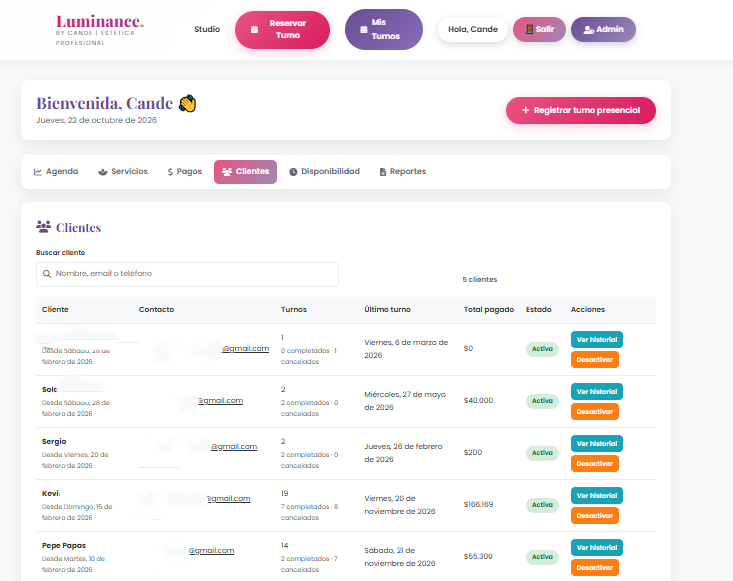

| Columna | Qué muestra |
|---|---|
| **Cliente** | Nombre y fecha de alta. |
| **Contacto** | Email y teléfono. |
| **Turnos** | Total de turnos, con cuántos fueron completados y cuántos cancelados. |
| **Último turno** | Fecha del turno más reciente. |
| **Total pagado** | Suma de sus pagos aprobados. |
| **Estado** | Cuenta activa o desactivada. |

Acciones:

- **Ver historial:** abre todos los turnos de la clienta, con su fecha, servicio, estado y pago.
- **Desactivar / Activar:** una cuenta desactivada **no puede iniciar sesión**. Sus turnos y pagos se conservan, y se puede reactivar en cualquier momento.

El buscador filtra por nombre, email o teléfono.

## 12. Horarios de atención y fechas especiales

La pestaña **Disponibilidad** define cuándo se pueden reservar turnos.

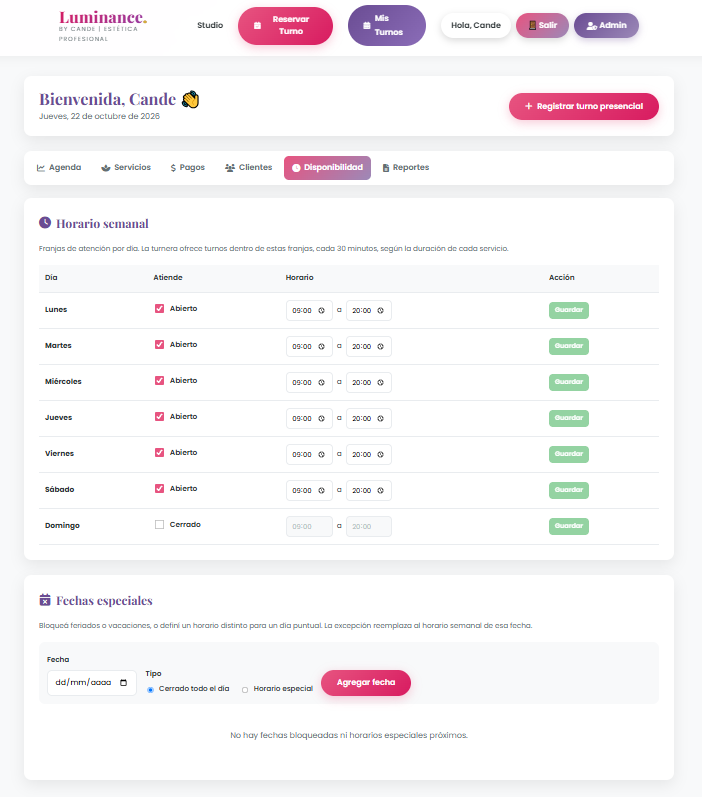

- **Horario semanal:** para cada día, marcá si está **Abierto**, indicá el horario de apertura y de cierre, y tocá **Guardar** en esa fila. La turnera ofrece turnos cada 30 minutos dentro de esa franja.
- **Fechas especiales:** para feriados, vacaciones o días con otro horario. Elegí la fecha y el tipo (**Cerrado todo el día** u **Horario especial**, con su franja) y tocá **Agregar fecha**. Ese día, la fecha especial **reemplaza** al horario semanal.

> [!NOTE]
> Cambiar los horarios no cancela turnos ya reservados. Si cerrás un día con turnos tomados,
> revisalos en la Agenda y avisales a las clientas.

## 13. Reportes y métricas

La pestaña **Reportes** resume el año seleccionado en el selector **Año**.

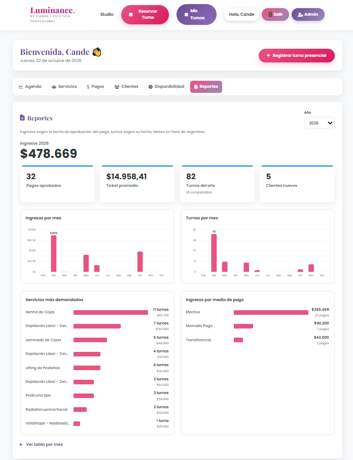

### Cómo leer cada bloque

| Bloque | Interpretación |
|---|---|
| **Ingresos del año** | Total cobrado: suma de los pagos aprobados en el año. |
| **Pagos aprobados** | Cantidad de cobros del año. |
| **Ticket promedio** | Ingresos ÷ pagos aprobados: cuánto deja, en promedio, cada cobro. |
| **Turnos del año** | Turnos con fecha en el año. Debajo, cuántos se completaron. |
| **Clientes nuevos** | Cuentas creadas en el año. |
| **Ingresos por mes** | Barras con lo cobrado cada mes. Permite ver la estacionalidad y los meses fuertes. |
| **Turnos por mes** | Barras con la cantidad de turnos de cada mes. |
| **Servicios más demandados** | Ranking por cantidad de turnos, con lo facturado por cada servicio. |
| **Ingresos por medio de pago** | Cuánto ingresó por efectivo, Mercado Pago y transferencia, con la cantidad de pagos. |
| **Ver tabla por mes** | Detalle mensual: ingresos, pagos, turnos, completados y cancelados. |

Criterios importantes para interpretar los números:

- Los **ingresos** se cuentan según la **fecha de aprobación del pago**, no según la fecha del turno. Un turno de marzo pagado en febrero suma a febrero.
- Los **turnos** se cuentan según la **fecha del turno**.
- Los meses se calculan en **hora de Argentina**.
- Una diferencia grande entre *Turnos del año* y *completados* puede indicar cancelaciones frecuentes o turnos que falta marcar como **Completado** en la Agenda.

---

## Preguntas frecuentes

**¿Por qué no aparece un horario que antes estaba libre?**
Otra clienta lo confirmó, o ya falta menos de 2 horas para ese horario.

**Reservé pero no pagué, ¿tengo el turno?**
El turno queda pendiente, pero el horario no está asegurado hasta que se aprueba el pago. Podés pagarlo desde **Mis Turnos → Pagar**.

**Pagué con Mercado Pago y el turno sigue pendiente.**
La confirmación puede demorar unos instantes. Actualizá **Mis Turnos**. Si sigue pendiente, contactá al estudio por WhatsApp.

**¿Puedo cambiar la fecha de un turno confirmado?**
Sí: tocá **Solicitar Reprogramar** en **Mis Turnos** y coordiná la nueva fecha con el estudio.

**El sitio tarda en cargar la primera vez.**
El servidor puede tardar unos segundos en responder después de un rato sin uso. Esperá y volvé a intentar.
