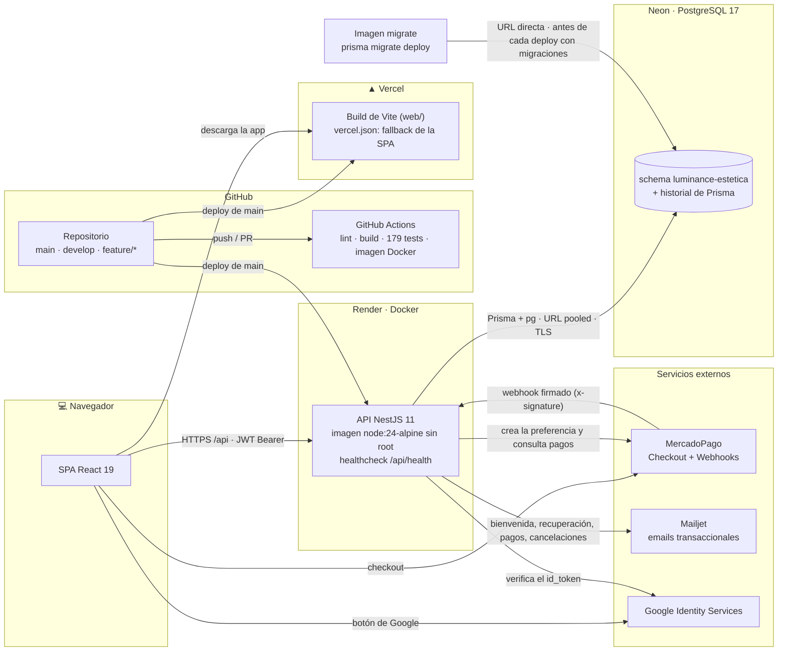

# Diagrama de despliegue

Cómo se conectan en producción el frontend, la API, la base de datos y los servicios externos.
Procedimiento detallado de deploy y migraciones: [`backend/docs/DEPLOY.md`](../../backend/docs/DEPLOY.md).

## Componentes

| Componente | Plataforma | Detalle |
|---|---|---|
| **Frontend** | Vercel | `web/` como raíz del proyecto. Vite genera estáticos; `vercel.json` redirige cualquier ruta a `index.html`. La URL de la API se resuelve en `web/src/config/api.ts`. |
| **API** | Render (Web Service Docker) | Imagen multistage de [`backend/Dockerfile`](../../backend/Dockerfile): solo `dist/` y dependencias de producción, usuario `node`, `HEALTHCHECK`. Las variables (`DATABASE_URL`, `SECRET_KEY`, credenciales) se configuran en Render. |
| **Base de datos** | Neon | PostgreSQL 17. La API usa la URL *pooled*; las migraciones, la *directa*. El historial de Prisma vive en el schema de la app para no tocar `public`, que es compartido. |
| **Migraciones** | Imagen `migrate` | Target aparte del Dockerfile con el CLI de Prisma. Incluye `npm run db:diagnose`, un chequeo de solo lectura antes de migrar. |
| **Pagos** | MercadoPago | La API crea la preferencia con el precio de la base y `external_reference` = ID del turno. El webhook valida la firma HMAC y consulta el estado real del pago. |
| **Login con Google** | Google Identity Services | El navegador obtiene un `id_token` y la API valida firma, audiencia y email verificado con `google-auth-library`. |
| **Emails** | Mailjet | API REST v3.1. Si un envío falla, se registra en el log y no corta el flujo del usuario. |
| **CI** | GitHub Actions | Frontend, backend (con PostgreSQL de servicio), Playwright E2E y build de imágenes en cada push y PR a `main` y `develop`. |

## Plan gratuito

Render y Neon suspenden los servicios sin tráfico. La primera petición después de un rato
despierta la API (30 a 60 segundos) y, si estaba suspendida, también la base; después responde
con normalidad.
