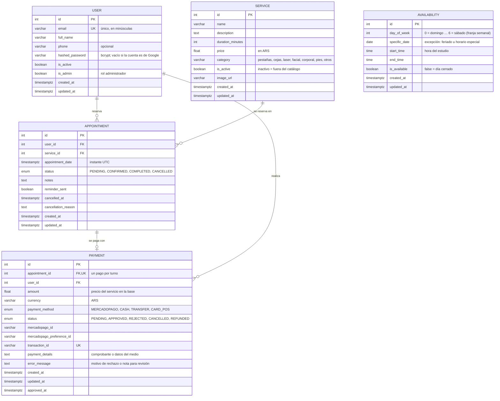
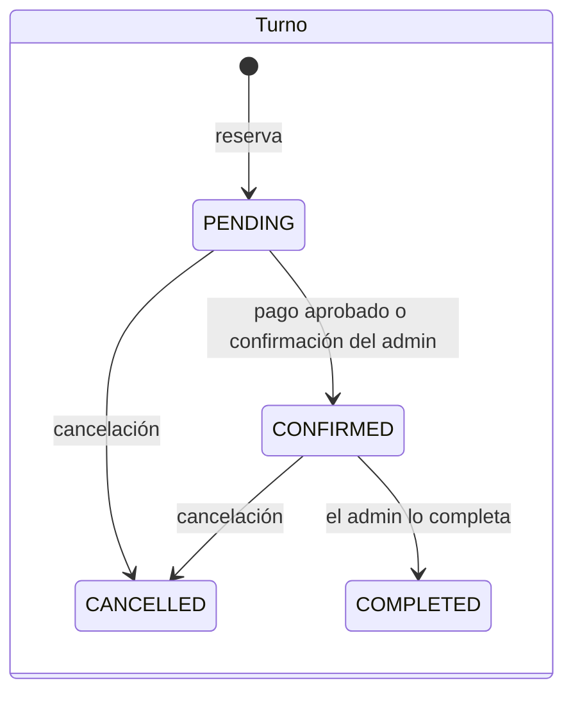
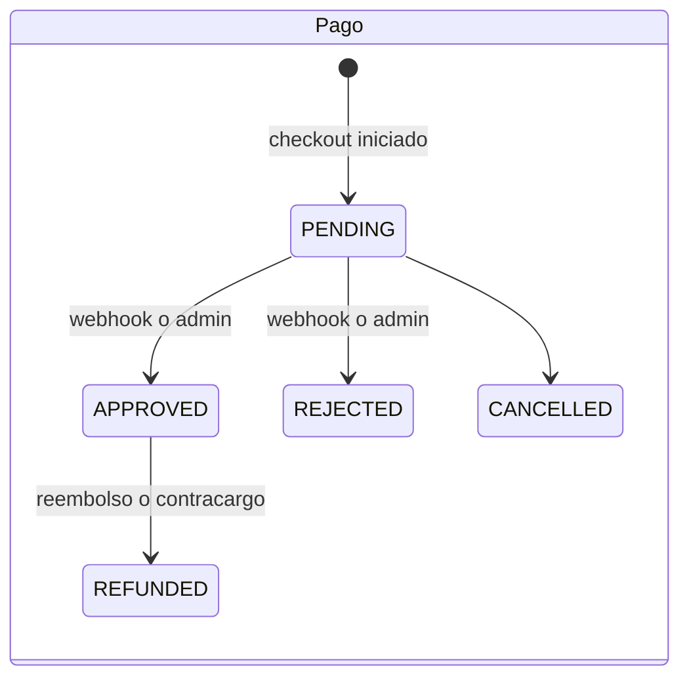

# Diagrama Entidad-Relación

Modelo de datos de la API, definido en [`backend/prisma/schema.prisma`](../../backend/prisma/schema.prisma).
Todas las tablas viven en el schema PostgreSQL `luminance-estetica` (la base de Neon es compartida
con otros proyectos) y las fechas se guardan como `timestamptz`, es decir, como instantes UTC.

## Relaciones

| Relación | Cardinalidad | Regla |
|---|---|---|
| `User` → `Appointment` | 1 a N | Cada turno pertenece a una clienta (o al admin, si reserva en el estudio). |
| `Service` → `Appointment` | 1 a N | Un servicio con turnos no se puede eliminar; se desactiva. |
| `Appointment` → `Payment` | 1 a 0..1 | `appointment_id` es único: reintentar un pago reutiliza el mismo registro. |
| `User` → `Payment` | 1 a N | Permite listar los pagos de cada clienta y el total pagado. |

`Availability` no tiene claves foráneas. Cada fila es **una franja semanal** (`day_of_week`) o
**una excepción** para una fecha (`specific_date`): nunca las dos a la vez. Para calcular el horario
de un día se toma la excepción de esa fecha si existe y, si no, la franja semanal.

## Estados

Solo un turno **CONFIRMED** ocupa su horario, durante la duración de su servicio. Un pago aprobado
nunca vuelve atrás por una notificación tardía: la única salida es el reembolso.

> La tabla `coupons` existe en la base (heredada de la primera versión) pero ningún flujo la usa
> todavía, por eso no aparece en el diagrama.
