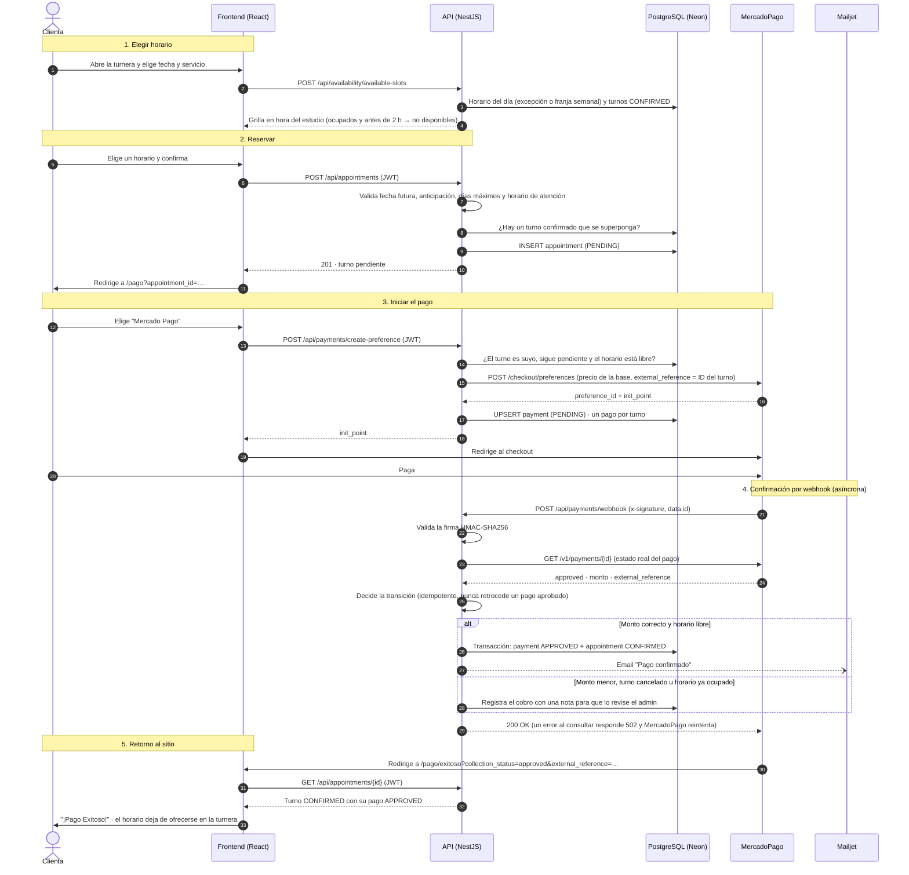

# Secuencia: reserva y pago con MercadoPago

Flujo completo desde que la clienta elige un horario hasta que el turno queda confirmado.
Es el mismo flujo que verifica el test E2E `turnera → pago con MercadoPago → retorno al sitio`
([`web/e2e/booking.spec.ts`](../../web/e2e/booking.spec.ts)).

## Puntos clave

- **Precio confiable:** el monto que envía el navegador se ignora; se cobra el precio del
  servicio guardado en la base.
- **Webhook seguro e idempotente:** se valida la firma y se consulta a MercadoPago el estado real
  del pago, sin confiar en el contenido de la notificación. Las notificaciones repetidas o
  desordenadas no duplican confirmaciones ni emails.
- **El horario se ocupa al confirmar:** un turno `PENDING` no bloquea la agenda; un turno
  `CONFIRMED` sí, durante la duración de su servicio. Por eso la API vuelve a revisar
  superposiciones al iniciar el pago y al confirmarlo.
- **Retorno y webhook son independientes:** la página `/pago/exitoso` consulta el turno a la API,
  y la confirmación la hace siempre el webhook.
- **Tarjeta rechazada:** MercadoPago redirige a `/pago/fallido` y el webhook marca el pago como
  `REJECTED`. El turno sigue pendiente y la clienta puede reintentar; se reutiliza el mismo pago.
- **Pago en efectivo:** la clienta lo coordina por WhatsApp y el admin lo registra desde el panel
  con `POST /api/payments/cash-payment`, que confirma el turno.
