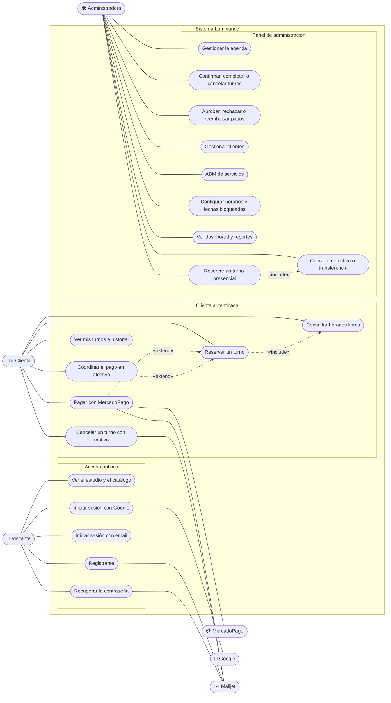

# Casos de uso

Qué puede hacer cada actor en el sistema. Mermaid no tiene un tipo de diagrama UML de casos de uso:
se representa con un diagrama de flujo donde los actores están fuera del sistema y cada caso de uso
es un óvalo dentro de él.

## Actores

| Actor | Descripción |
|---|---|
| **Visitante** | Persona sin sesión. Ve el estudio y el catálogo, y puede crear una cuenta o ingresar. |
| **Clienta** | Usuaria autenticada (`is_admin = false`). Reserva, paga y gestiona sus turnos. Hereda lo que puede hacer el visitante. |
| **Administradora** | Usuaria con `is_admin = true`. Accede al panel (`/admin`, protegido por `JwtAuthGuard` + `AdminGuard`) y también puede usar la turnera. |
| **MercadoPago** | Actor externo: procesa el cobro y notifica a la API por webhook. |
| **Google** | Actor externo: autentica a la usuaria y emite el `id_token` que valida la API. |
| **Mailjet** | Actor externo: entrega los emails de bienvenida, recuperación, pago confirmado y cancelación. |

## Casos de uso principales

| Caso de uso | Actor | Endpoint principal | Reglas |
|---|---|---|---|
| Reservar un turno | Clienta | `POST /api/appointments` | Fecha futura, al menos 2 h de anticipación, hasta 30 días, dentro del horario de atención y sin superponerse con un turno confirmado. Queda `PENDING`. |
| Pagar con MercadoPago | Clienta | `POST /api/payments/create-preference` | Solo turnos propios y pendientes; se cobra el precio de la base. Lo confirma el webhook. |
| Cancelar un turno | Clienta / Admin | `POST /api/appointments/:id/cancel` | Motivo de 5 a 500 caracteres; solo la dueña del turno o un admin. |
| Gestionar la agenda | Admin | `GET /api/admin/appointments` | Filtros por día, rango y estado; búsqueda por nombre, email, teléfono, servicio o `#ID`. |
| Confirmar, completar o cancelar | Admin | `PUT /api/appointments/:id` | PENDING → CONFIRMED / CANCELLED; CONFIRMED → COMPLETED / CANCELLED. |
| Cobrar en efectivo o transferencia | Admin | `POST /api/payments/cash-payment` | Aprueba el pago y confirma el turno, salvo que el horario ya esté ocupado. |
| Aprobar o rechazar pagos | Admin | `PUT /api/payments/:id/status` | Rechazar deja el turno pendiente de pago para que la clienta reintente. |
| Gestionar clientes | Admin | `GET /api/admin/clients` · `PUT /api/users/:id/toggle-active` | Métricas por clienta; una cuenta desactivada no puede iniciar sesión. |
| ABM de servicios | Admin | `/api/services` | Nombre único; un servicio con turnos no se elimina, se desactiva. |
| Configurar disponibilidad | Admin | `/api/availability/regular` · `/exceptions` | Franjas semanales y fechas cerradas o con horario especial. |
| Dashboard y reportes | Admin | `GET /api/admin/dashboard` · `/reports/yearly` | Métricas por mes en la hora del estudio; cobrado vs. por cobrar. |

La lista completa de endpoints está en [`backend/README.md`](../../backend/README.md#endpoints).
